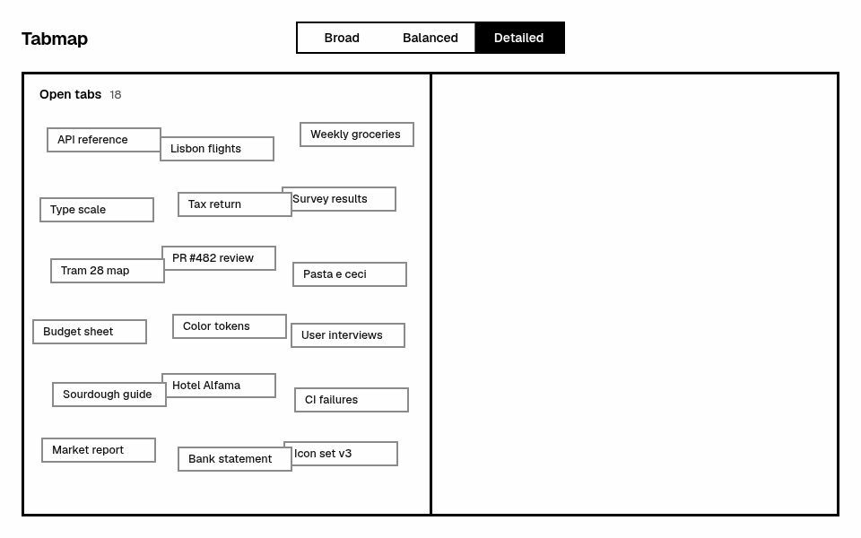
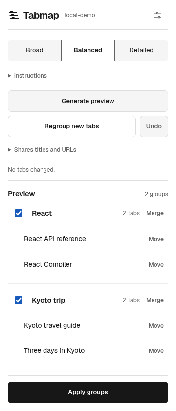

<div align="center">
  <picture>
    <source media="(prefers-color-scheme: dark)" srcset="https://raw.githubusercontent.com/Microck/tabmap/main/.github/assets/tabmap-dark.svg">
    
  </picture>
  <h1>tabmap</h1>
  <p>group your browser tabs with codex or an openai-compatible model.</p>
  <p>
    <a href="https://github.com/Microck/tabmap/releases/latest"><picture><source media="(prefers-color-scheme: dark)" srcset="https://shieldcn.dev/badge/release-0.1.1.svg?variant=secondary&amp;size=xs&amp;logo=false&amp;mode=dark"></picture></a>
    <a href="https://github.com/Microck/tabmap/blob/main/LICENSE"><picture><source media="(prefers-color-scheme: dark)" srcset="https://shieldcn.dev/badge/license-MIT.svg?variant=secondary&amp;size=xs&amp;logo=false&amp;mode=dark"></picture></a>
  </p>
</div>

---

`tabmap` groups related tabs in your current browser window. generate a preview,
rename or merge groups, move tabs between them, then apply the result. nothing
moves until you choose `Apply groups`.

use your codex account through the supplied connector, or connect directly to an
openai-compatible api. pinned tabs and existing group members stay in place.
`Regroup new tabs` checks additions without reclassifying everything you already
checked.

[download](https://github.com/Microck/tabmap/releases/download/v0.1.1/tabmap-0.1.1.zip) | [privacy](https://github.com/Microck/tabmap/blob/main/docs/privacy.md) | [verification](https://github.com/Microck/tabmap/blob/main/docs/verification.md)

<p align="center">
  <picture>
    <source media="(prefers-reduced-motion: reduce)" srcset=".github/assets/tabmap-showcase.png">
    
  </picture>
</p>

<p align="center">
  <picture>
    <source media="(prefers-color-scheme: dark)" srcset="https://raw.githubusercontent.com/Microck/tabmap/main/.github/assets/panel-dark.png">
    
  </picture>
</p>

<p align="center"><sub>sample tabs, local response fixture.</sub></p>

## install

use a current desktop version of chrome, chromium or edge. the release is an
unpacked extension, not a chrome web store install.

1. [download tabmap-0.1.1.zip](https://github.com/Microck/tabmap/releases/download/v0.1.1/tabmap-0.1.1.zip) and extract it to a permanent folder.
2. open `chrome://extensions` or `edge://extensions` and turn on `Developer mode`.
3. choose `Load unpacked` and select the extracted folder containing `manifest.json`.
4. pin tabmap to the toolbar and open it.

keep the extracted folder in place. moving it breaks the installation. after
replacing the files with an update, click reload on the extension's card and
reopen its panel.

the zip contains only the extension and its licenses, with `manifest.json` at the
root. the optional codex connector is a separate download.

[checksums.txt](https://github.com/Microck/tabmap/releases/download/v0.1.1/checksums.txt)
contains both zips' sha-256 checksums. building from source is optional.

## connect a provider

### codex

requires node.js 22 or later and [codex cli](https://developers.openai.com/codex/cli/).
the connector has its own one-time chatgpt login. it does not copy your coding
configuration or credentials, and you do not paste an oauth token into tabmap.

[download tabmap-connector-0.1.1.zip](https://github.com/Microck/tabmap/releases/download/v0.1.1/tabmap-connector-0.1.1.zip)
and extract it to a separate permanent folder. from that folder, run:

```sh
node install.js --extension-id dphchnnplpipipcpagehefaienlnjnnj --browser chrome --login
```

use `--browser edge` or `--browser chromium` for those browsers. on windows,
`--codex-path` must point to `codex.exe`, not an npm `.cmd` wrapper. use that flag
on any platform if the executable is not on your path.

in tabmap, open `Settings`, select `Codex connector`, save, and choose
`Load models`. pick a model offered by your account and save it. model access and
usage limits depend on that account.

keep the connector directory and node installation in place. the browser starts
the connector when needed; you do not run a separate server. codex inference is
remote, not on-device. the connector uses permission-profile and empty-environment
support checked against codex 0.166.0. see [verification](https://github.com/Microck/tabmap/blob/main/docs/verification.md)
for the tested scope.

### openai-compatible api

you do not need codex, node or the connector for this option.

in `Settings`, select `OpenAI-compatible API`, enter the base url, key and model,
then save and approve access to that host. use `Load models` or enter a model id
provided by your service.

the endpoint must support `POST /chat/completions`; discovery uses `GET /models`.
include a version path when required, such as `https://api.openai.com/v1`.
remote endpoints need https. loopback http is allowed on `localhost`,
`127.0.0.1` and `[::1]`.

api usage may cost money. keys are stored unencrypted in this device's extension
storage, not browser sync. use a restricted key with a spending limit. clear the
key field and save to remove it.

## group your tabs

1. choose `Broad`, `Balanced` or `Detailed`. add optional `Instructions`.
2. choose `Generate preview` and inspect the result.
3. rename groups, uncheck ones to leave out, or use `Merge` and `Move`.
4. choose `Apply groups`. use `Undo` before making further tab-layout changes.

broad makes fewer, larger groups. balanced is the default. detailed separates
narrower projects and tasks. these are preferences, not fixed group counts.
instructions can contain up to 2,000 characters. ctrl+enter or command+enter in
the instructions field generates a preview.

local edits do not call the model. closing or reloading the panel discards those
edits and restores the model's proposal. existing browser-group names are
read-only, and their old members never appear as movable preview tabs.

if moving a tab leaves a new group with one member, that member becomes ungrouped.
a single addition to an existing group is valid.

### check only new tabs

after a successful check, open more tabs and choose `Regroup new tabs`. new tabs
can join existing named groups or form new ones. you can do this before applying
the earlier preview; its renamed groups, assignments and exclusions stay intact.

only previously unchecked eligible tab ids in this window are submitted. a failed
or cancelled request does not advance the checkpoint. browser restart clears it.
undoing, navigating an already checked tab, or leaving a tab ungrouped does not
make it new. use `Generate preview` to reconsider all eligible ungrouped tabs.

changing detail or instructions for regroup affects only the new tabs. successful
classification saves those preferences. a check with no new tabs leaves the draft
and saved preferences unchanged.

## privacy and limits

tabmap sends eligible tab titles and sanitized urls to your chosen provider,
plus grouping preferences and destination group names and member counts. urls
lose credentials, queries and fragments, but titles and paths may still contain
private information. existing members' titles and urls are not resubmitted.

it does not read page contents, cookies, browsing history or incognito tabs.
there is no developer relay or analytics. read the [privacy details](https://github.com/Microck/tabmap/blob/main/docs/privacy.md)
before using it with sensitive tabs.

- only ungrouped, unpinned web tabs in the current window are eligible.
- a check accepts up to 400 tabs and 400 named destinations. use another window above those limits.
- the model can leave tabs ungrouped or make questionable assignments. inspect the preview.
- two or more submitted tabs use two model calls. a single tab with a destination uses one; a lone tab without a destination needs none.
- tabs changing after preview make it stale. generate another preview instead of applying an old plan.
- undo refuses to overwrite later layout changes. browser mutations are not transactional; inspect recovery status after a partial failure.

large mixed-topic windows can take over a minute and need a capable model. tabmap
never silently switches your provider or model. testing used linux arm64 and
chromium; macos, windows, edge and older chromium builds remain unverified.

## troubleshooting

- **connector not found:** rerun the installer with the id and browser shown in `Settings`. keep the connector folder where you installed it.
- **codex login missing:** rerun the connector installer with `--login`. a normal `codex login` uses a different home.
- **instruction isolation rejected:** keep the connector's dedicated home free of custom instructions and integrations. it stops if codex reports loaded instruction files.
- **api request rejected:** check the endpoint, key, quota and model access. a chatgpt login is not an openai api key.
- **invalid model output:** tabs stay unchanged. choose a model that can follow the required json schema.
- **apply disabled after editing preferences:** generate a new preview, or revert to the saved preferences.
- **old behavior after updating:** reload the unpacked extension and reopen the panel.

## build from source

```sh
git clone https://github.com/Microck/tabmap.git
cd tabmap
bun install --frozen-lockfile
bun run typecheck
bun run lint
bun run test:core
bun run build
```

load `dist/extension`. the native connector and installer are in `dist/connector`.
lint reports existing complexity warnings; see the [verification notes](https://github.com/Microck/tabmap/blob/main/docs/verification.md)
for actual checks and untested platforms.

## license

[mit](https://github.com/Microck/tabmap/blob/main/LICENSE). the bundled geist font
keeps its [sil open font license](https://github.com/Microck/tabmap/blob/main/public/fonts/geist-license.txt).
